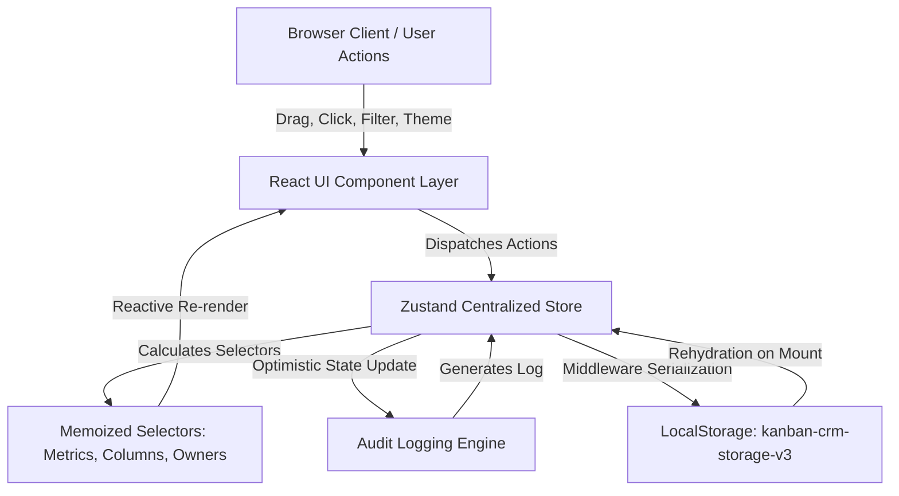
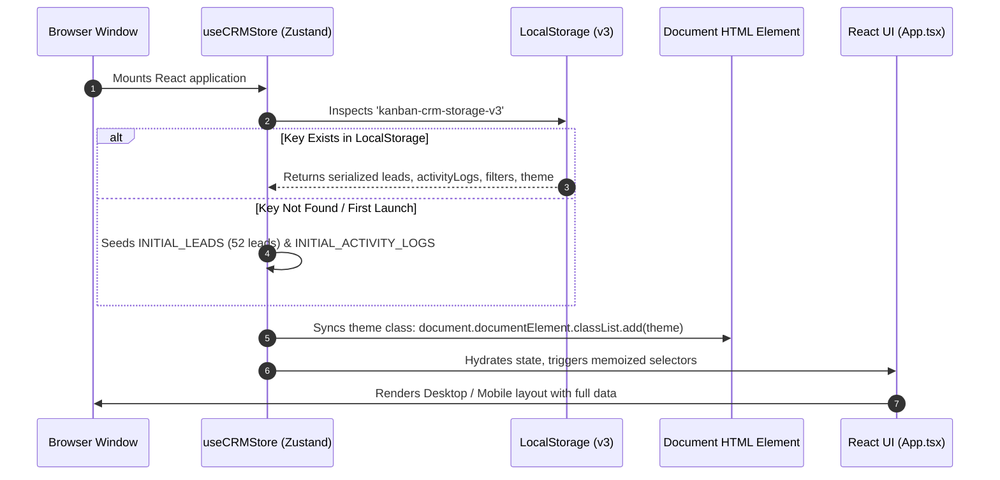
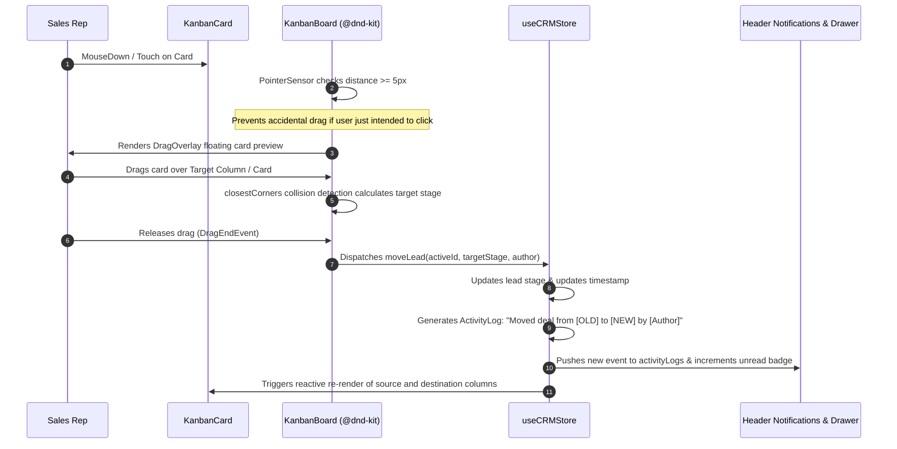
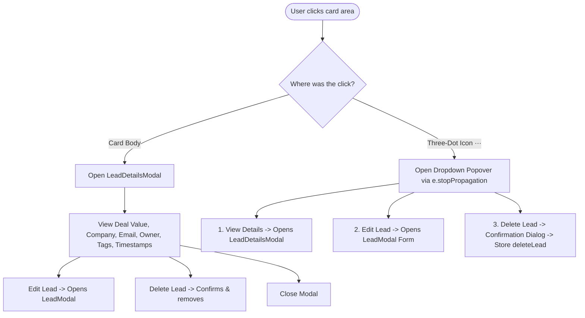
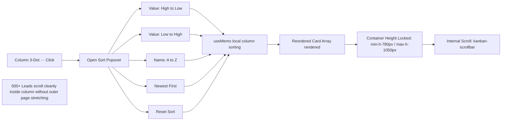

# Enterprise Kanban CRM — Project Flow & Architecture Document

This document provides a comprehensive end-to-end breakdown of the application architecture, data lifecycle, component hierarchy, user interaction flows, and state management mechanisms for the **Enterprise Kanban CRM**.

---

## 1. High-Level Architecture Overview

The system is built on a unidirectional, reactive client-side architecture with zero backend dependency. State transitions, audit logging, and local persistence occur deterministically through a centralized state machine.



---

## 2. Component Hierarchy Tree

```text
src/
├── main.tsx
└── App.tsx (Root Layout & View Controller)
    ├── Desktop Header (Header.tsx)
    │   ├── Logo & Brand PRO Badge
    │   ├── Global Search Bar (Ctrl+K shortcut)
    │   ├── User Profile Popover (Details, Settings, Static Logout)
    │   ├── Dark / Light Theme Toggle
    │   └── Notification Bell Popover (Live Activity Logs, Unread Badge)
    ├── Mobile Top Bar
    │   ├── User Avatar & App Title
    │   ├── Compact Theme Toggle
    │   └── Activity Drawer Trigger Bell
    ├── KPI Metrics Section
    │   ├── Desktop View: MetricCards.tsx (4-Grid KPI Cards)
    │   └── Mobile View: Stacked Row-by-Row Cards (100% Full-Width)
    ├── Desktop Kanban Pipeline Workspace
    │   ├── Sub-header & Filters Toolbar (Owners Dropdown, Stages Dropdown)
    │   └── KanbanBoard.tsx (DnD Context Coordinator)
    │       ├── DragOverlay Preview (Floating Card Shadow)
    │       └── 5x KanbanColumn.tsx (New, Contacted, Qualified, Won, Lost)
    │           ├── Column Header (Stage Badge, Top Accent Track)
    │           ├── Column Three-Dot (···) Popover (Add Lead, 4 Sort Modes, Reset)
    │           └── SortableContext (KanbanCard.tsx Array)
    │               ├── Avatar / Initials & 20+ Char Truncated Name/Email
    │               ├── Lead Three-Dot (···) Popover (View Details, Edit, Delete)
    │               ├── Stage Tag Chips
    │               └── Owner Name & Formatted Deal Value ($)
    ├── Mobile Responsive Pipeline Workspace
    │   ├── Horizontal Stage Tabs Bar (with count badges)
    │   └── Active Stage Container
    │       ├── Mobile Column Header
    │       ├── Mobile Three-Dot (···) Popover (Owner Filter, Sort Modes, Add Lead)
    │       ├── Active Filter Tag Chips (One-tap clear)
    │       ├── Dedicated Scroll Viewport (max-h-[660px] overflow-y-auto)
    │       └── Full-Width + New Lead Button
    ├── Modals & Drawers
    │   ├── LeadDetailsModal.tsx (Read-only dossier view)
    │   ├── LeadModal.tsx (Create / Edit Lead Form)
    │   └── ActivityHistoryPanel.tsx (Slide-over audit trail drawer)
```

---

## 3. Detailed Data Lifecycle & User Interaction Flows

### Flow 1: Application Bootstrap & Offline Hydration



---

### Flow 2: Drag-and-Drop Pipeline Movement



---

### Flow 3: Lead Card Interaction (Dossier View vs. Dropdown Actions)



---

### Flow 4: Column Sorting & 500+ Leads Performance Management



---

### Flow 5: Live Notifications & Activity Audit Trail

1. **Event Trigger**: When any mutation occurs (`moveLead`, `addLead`, `updateLead`, `deleteLead`), an immutable audit log is added to `activityLogs`:
   ```ts
   {
     id: "act-...",
     leadId: "...",
     leadName: "...",
     action: "STAGE_CHANGED" | "CREATED" | "UPDATED" | "DELETED",
     description: "Moved deal from [Contacted] to [Qualified] — Quantum BioLabs ($184,300)",
     timestamp: "2026-10-15T...",
     author: "Siela",
     badgeColor: "blue"
   }
   ```
2. **Synchronized Consumers**:
   - **Header Bell**: Inspects `activityLogs`, checks unread status via local `readLogIds` set, displays unread badge counter (`3 new`).
   - **Activity Drawer**: Opens `ActivityHistoryPanel.tsx`, displaying connecting vertical timeline nodes with relative time stamps (`14m ago`, `1h ago`).
   - **Mobile Bottom Activity**: Displays the top recent events with lead names and descriptions.

---

### Flow 6: Mobile Pipeline Adaptation (< 768px)

1. **KPI Metrics Section**:
   - Replaced horizontal scroll with 4 stacked full-width rows (`grid grid-cols-1 gap-2.5`).
   - Displays **Total Leads**, **Qualified Leads**, **Won Deals**, and **Pipeline Value** with zero clipping.
2. **Stage Tabs**:
   - Tap tab (`New`, `Contacted`, `Qualified`, `Won`, `Lost`) to switch `activeMobileStage`.
3. **Mobile Stage Column Header Dropdown**:
   - Tapping `···` opens popover with **Filter by Owner** (All Owners, Sangili, Siela, etc.) and **4 Sorting Modes**.
   - Active filter chips appear under the header with one-tap dismissal (`×`).
4. **Scroll Viewport**:
   - Configured with `max-h-[660px] overflow-y-auto overscroll-contain` so all leads in that stage can be browsed smoothly.

---

## 4. State Management Contract (`useCRMStore`)

### State Shape
| Property | Type | Description |
| :--- | :--- | :--- |
| `leads` | `Lead[]` | Array of 52+ leads across all stages. |
| `activityLogs` | `ActivityLog[]` | Chronological audit trail of sales pipeline actions. |
| `filters` | `CRMFilterState` | `{ searchQuery, selectedOwner, selectedStage }`. |
| `theme` | `'dark' \| 'light'` | Active theme mode. |
| `selectedLeadId` | `string \| null` | Currently active lead for modals. |
| `isLeadModalOpen` | `boolean` | Add/Edit modal visibility. |
| `isActivityDrawerOpen`| `boolean` | Slide-over drawer visibility. |

### Memoized Selectors
- **`selectMetrics(state)`**: Computes `totalLeads`, `qualifiedLeads`, `wonDeals`, and `totalPipelineValue` (excluding lost deals).
- **`selectLeadsByStage(state)`**: Partitions filtered leads into `{ NEW: Lead[], CONTACTED: Lead[], ... }` in an O(N) pass.
- **`selectUniqueOwners(state)`**: Extracts distinct owner names for filtering dropdowns.

---

## 5. Defensive UX Implementations

1. **20+ to 45+ Character Text Overflow Protection**:
   - Card avatars and names use `min-w-0 flex-1 truncate block w-full` with HTML `title={lead.name}`.
   - Long names like `"Alexander Bartholomew-Montgomery"` and emails like `"alexander.bartholomew@multinational-enterprise.corp"` truncate smoothly without pushing buttons or deal values offscreen.
2. **Sensors Distance Activation Guard**:
   - `@dnd-kit` configured with `activationConstraint: { distance: 5 }`.
   - Prevents click events on cards and menu buttons from being swallowed or triggering unintentional card dragging.
3. **Isolated Scrolling Containers**:
   - `overscroll-contain` applied on both the Activity History drawer and the mobile pipeline viewport to prevent scroll chaining to the outer window.
4. **Theme Contrast Auditing**:
   - Dark mode uses rich obsidian `#0B0F19` with `#141E30` card surfaces and glowing trend pills.
   - Light mode uses high-contrast slate `#F8FAFC` canvas with `#FFFFFF` card surfaces and tailored border definitions.
